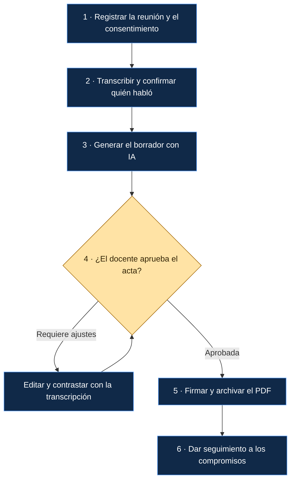
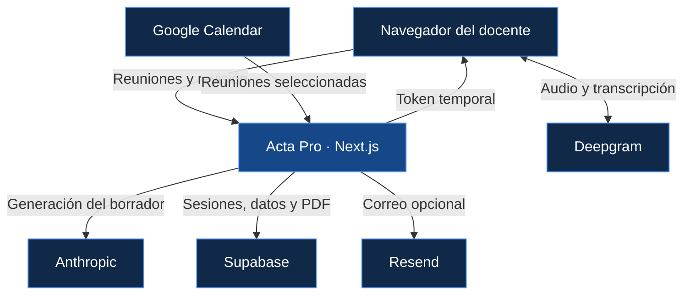

# ACTA PRO

**Menos trámites. Más educación.**

Acta Pro ayuda al docente a documentar las reuniones con familias y autoridades. A partir de una conversación grabada con consentimiento, prepara un borrador de acta que vincula cada acuerdo con el fragmento que lo respalda. El docente revisa y aprueba el documento antes de recoger las firmas. Después puede consultar quién asumió cada compromiso y actualizar su avance.

[Cómo funciona](#cómo-funciona) · [Probar el MVP](#probar-el-mvp) · [Arquitectura](#arquitectura-del-mvp) · [Impacto](#impacto-y-modelo-de-negocio)

## Cómo funciona



**La IA propone. El docente revisa y decide.** El micrófono se habilita cuando todos los participantes han dado su consentimiento. El tablero conserva el responsable y la fecha que constan en el acta. El docente registra el avance de cada compromiso.

| Usuario | Qué aporta Acta Pro |
| --- | --- |
| Docente | Puede comprobar qué se dijo al revisar el borrador y retomar los acuerdos en la siguiente reunión. |
| Institución educativa | Reúne las actas en un repositorio con historial por estudiante y registro de acciones. |
| Representante | Puede consultar el documento firmado y los compromisos acordados. |
| Estudiante | Recibe acompañamiento a partir de acuerdos que la institución y la familia pueden retomar. |

## Probar el MVP

```bash
git clone https://github.com/Pablinvb/acta-pro-mvp.git
cd acta-pro-mvp
npm install
npm run dev
```

Abra <http://localhost:3000> y use las credenciales de demostración que aparecen en pantalla. El modo demo funciona sin claves de API. **Cargar transcripción de demostración** permite probar la revisión, las firmas, el PDF y el seguimiento con datos ficticios. La interfaz identifica las simulaciones. Sin Supabase, reiniciar el servidor restablece los datos iniciales.

## Arquitectura del MVP

**Captura y transcripción.** El MVP captura el audio desde el navegador y utiliza Deepgram para transcribirlo. La arquitectura objetivo contempla **PLAUD** como dispositivo opcional de grabación. Su conexión directa con Acta Pro está pendiente de confirmación.



| Servicio | Función en el modo real |
| --- | --- |
| Deepgram | Transcribe la conversación y separa las intervenciones por hablante. El docente confirma la identidad de cada persona. |
| Anthropic | Organiza los temas, hechos y acuerdos en un borrador con referencias a la transcripción. |
| Supabase | Gestiona la autenticación, la base de datos y el almacenamiento privado de los PDF. |
| Resend y Google Calendar | Integraciones opcionales para enviar el acta por correo e importar reuniones seleccionadas, respectivamente. |

## Privacidad y trazabilidad

| Control | Alcance |
| --- | --- |
| Audio | El sistema lo procesa para transcribirlo y lo descarta. |
| Revisión | La transcripción original se conserva. Las correcciones se registran como versiones del acta. |
| Firmas | El docente y el representante firman en el mismo dispositivo. Se recogen firmas manuscritas digitalizadas. La verificación de identidad de los firmantes está pendiente. |
| Integridad | Una huella SHA-256 permite comprobar si el PDF cambió después de archivarse. La descarga requiere autenticación y comprobación de la institución. |
| Datos escolares | El proveedor simulado de estudiantes utiliza datos ficticios. La integración con Runachay está fuera del alcance actual. |

## Impacto y modelo de negocio

Acta Pro propone una suscripción institucional mensual o anual según el número de docentes y el volumen de actas. El modelo plantea **el siguiente escenario hipotético, pendiente de validación mediante un piloto**.

| Indicador | Proyección |
| --- | ---: |
| Tiempo de documentación por reunión | De 30 a 5 minutos |
| Reducción del tiempo de documentación | 83,3 % |
| Capacidad recuperada con 50 docentes y 4 reuniones mensuales por docente | 83,3 horas al mes |

## Documentación técnica

[Arquitectura](docs/ARCHITECTURE.md) · [Privacidad](docs/PRIVACY_CHECKLIST.md) · [Despliegue](docs/DEPLOY.md)

Idioma: español de Ecuador · Zona horaria: `America/Guayaquil`.

<details>
<summary>Configuración con APIs reales</summary>

1. Copie el archivo de ejemplo:

```bash
cp .env.example .env.local
```

2. Complete las variables y compruebe el formato sin exponer valores:

```bash
npm run check:env
```

### Integraciones indispensables

| Servicio | Para qué | Variables |
| --- | --- | --- |
| Supabase | Autenticación, Postgres y almacenamiento privado de PDF | `NEXT_PUBLIC_SUPABASE_URL`, `NEXT_PUBLIC_SUPABASE_PUBLISHABLE_KEY`, `SUPABASE_SERVICE_ROLE_KEY` |
| Deepgram | Transcripción en vivo y diarización | `DEEPGRAM_API_KEY` |
| Anthropic | Borrador estructurado del acta | `ANTHROPIC_API_KEY`, `ANTHROPIC_MODEL` |

### Integraciones opcionales

| Servicio | Para qué | Variables |
| --- | --- | --- |
| Resend | Envío real del acta | `RESEND_API_KEY`, `EMAIL_FROM` (dominio verificado) |
| Google Calendar | Importar reuniones programadas | `GOOGLE_CLIENT_ID`, `GOOGLE_CLIENT_SECRET`, `GOOGLE_REDIRECT_URI`, `TOKEN_ENCRYPTION_KEY` |

Genere la clave de cifrado de tokens (32 bytes en Base64):

```bash
node -e "console.log(require('crypto').randomBytes(32).toString('base64'))"
```

Registre en Google Cloud exactamente estos URI de redirección:

- Desarrollo: `http://localhost:3000/api/integrations/google/callback`
- Producción: `https://SU-DOMINIO/api/integrations/google/callback`

Ponga `DEMO_MODE=false` **solo** cuando las tres integraciones indispensables estén configuradas. Si falta alguna, la aplicación dirige a `/settings/integrations` en lugar de continuar con simulaciones silenciosas.

</details>

<details>
<summary>Base de datos</summary>

Con el proyecto de Supabase creado, ejecute en el editor SQL, en este orden:

1. `supabase/migrations/0001_init.sql` — tablas, índices, funciones y políticas de Row Level Security.
2. `supabase/migrations/0002_storage.sql` — bucket privado `acta-documents`.
3. `supabase/migrations/0003_commitment_tracking.sql` — tablero de seguimiento de acuerdos.
4. `supabase/seed.sql` — datos ficticios de demostración.

El archivo de semilla necesita que el usuario docente exista antes en `auth.users`. Créelo desde **Authentication → Add user** con el correo `ana.perez@demo.actapro.ec` y ajuste el identificador en `seed.sql` si Supabase asigna otro.

Con el CLI de Supabase:

```bash
supabase db push
supabase db execute --file supabase/seed.sql
```

</details>

<details>
<summary>Comandos</summary>

| Comando | Qué hace |
| --- | --- |
| `npm run dev` | Servidor de desarrollo |
| `npm run build` | Compilación de producción |
| `npm run lint` | ESLint |
| `npm run typecheck` | TypeScript sin emitir |
| `npm test` | Pruebas unitarias y con mocks (Vitest) |
| `npm run test:coverage` | Cobertura de `src/lib` |
| `npm run test:e2e` | Prueba end-to-end del camino feliz (Playwright) |
| `npm run test:smoke` | Pruebas contra APIs reales; cada una se omite si falta su clave |
| `npm run check:env` | Presencia y formato de variables, sin imprimir valores |

La prueba end-to-end levanta su propio servidor en el puerto `3100` y necesita el navegador de Playwright:

```bash
npx playwright install chromium
```

</details>

<details>
<summary>Estructura</summary>

```
src/
  app/
    (app)/                  páginas autenticadas: dashboard, reuniones, actas, seguimiento, integraciones
    api/                    rutas de servidor: Deepgram, Anthropic, PDF, correo, Google, salud
    login/                  autenticación
  components/               interfaz accesible reutilizable, marca e iconografía
  lib/
    anthropic/              prompt y generación validada del acta
    api/                    errores, límite de tasa y utilidades HTTP
    crypto/                 cifrado AES-256-GCM de tokens de terceros
    data/                   contrato de repositorio + implementaciones demo y Supabase
    deepgram/               streaming en vivo, pregrabado y normalización de segmentos
    demo/                   datos semilla y generador determinístico de demostración
    pdf/                    documento del acta, huellas y códigos
    schemas/                MinutesSchema y normalización
  proxy.ts                  refresco de sesión y bloqueo de configuración incompleta
supabase/                   migraciones, RLS y datos semilla
scripts/check-env.ts        verificación de entorno
tests/                      unit, mocks, smoke y end-to-end
docs/                       arquitectura, privacidad y guion de demostración
```

</details>

<details>
<summary>Identidad visual</summary>

Tema oscuro institucional: azul marino profundo como fondo, azul eléctrico `#1F6FEB` como único acento de marca, verde reservado a lo verificado, ámbar a lo que exige revisión humana y rojo a la grabación en curso. Tipografía Inter. Los tokens viven en `src/app/globals.css` bajo `@theme`; los componentes no llevan colores literales.

Elementos propios de la identidad implementados como componentes:

- `LiveWaveform` — nivel de audio en tiempo real durante la grabación. Solo visualiza: lee un `AnalyserNode` y no graba ni envía nada.
- `StaticWaveform` — huella visual determinística de cada voz en la pantalla de hablantes. No reproduce audio, porque el audio no se conserva.
- `ProgressRing` — anillo de cumplimiento de acuerdos. Muestra `—` en lugar de `0 %` cuando todavía no hay compromisos.
- `FollowUpBoard` — tablero de responsables por semana, con avance en un clic.
- `LiveBadge` — indicador rojo pulsante de grabación en curso.

Todas las animaciones se desactivan con `prefers-reduced-motion`.

</details>

<details>
<summary>Diagnóstico cuando algo no funciona</summary>

```bash
npm run check:env   # presencia y formato, sin imprimir valores
```

```bash
npm run test:smoke  # golpea las APIs reales; omite lo que no tenga clave
```

Con la aplicación levantada, `GET /api/health/integrations` devuelve solo etiquetas de estado.

Tres fallos habituales y cómo se comporta la aplicación ante cada uno:

| Síntoma | Causa | Comportamiento |
| --- | --- | --- |
| «Supabase no responde» | El proyecto está pausado o borrado, o `NEXT_PUBLIC_SUPABASE_URL` tiene una errata. Compruébelo con `nslookup <ref>.supabase.co`: si el dominio no existe, el proyecto tampoco. | Con `DEMO_MODE=true` continúa en memoria y lo advierte en rojo. Con `DEMO_MODE=false` falla de forma visible: no sustituye datos reales por ficticios. |
| «La clave de Deepgram no tiene permiso para emitir tokens temporales» | La clave autentica pero le falta alcance sobre `/v1/auth/grant`. Cree una con rol de propietario o administrador del proyecto. | La transcripción en vivo se deshabilita; al finalizar transcribe el audio completo por la ruta pregrabada, que usa la misma clave y sí funciona. |
| El acta sale rotulada «Borrador de demostración» | Falta `ANTHROPIC_API_KEY`. | Usa el generador determinístico y lo declara en la propia acta. Nunca presenta como análisis algo que no lo fue. |

El botón **Cargar transcripción de demostración** funciona siempre que `DEMO_MODE=true`, incluso con Deepgram configurado: es el plan B de la demostración y su respuesta viene marcada como simulada.

</details>

<details>
<summary>Seguridad</summary>

- Ninguna clave de proveedor llega al navegador. Deepgram se usa desde el cliente con **tokens temporales** emitidos por el servidor.
- El bucket de documentos es privado; la descarga pasa por una ruta autenticada que comprueba la institución.
- Row Level Security en todas las tablas con datos institucionales.
- Los tokens de Google se guardan cifrados con AES-256-GCM.
- Los registros de consola no contienen transcripciones, firmas, correos ni secretos: solo recuentos e identificadores.
- La transcripción original es inmutable: las correcciones viven como versiones del acta.

</details>

<details>
<summary>Despliegue</summary>

**GitHub Pages no sirve para este proyecto.** Publica solo archivos estáticos y la aplicación necesita 17 rutas de servidor; llevarlas al navegador obligaría a exponer las claves en un repositorio público.

Guía completa en [`docs/DEPLOY.md`](docs/DEPLOY.md): Vercel para la aplicación y Supabase para datos y archivos, con la lista exacta de variables y la comprobación posterior.

- Aplicación en Vercel; datos y archivos en Supabase.
- Configure las mismas variables de entorno en el proyecto de Vercel y actualice `NEXT_PUBLIC_APP_URL` y `GOOGLE_REDIRECT_URI` al dominio de producción.
- El límite de tasa es en memoria por proceso: para varias instancias sustitúyalo por un almacén compartido antes de un uso institucional real.

</details>

